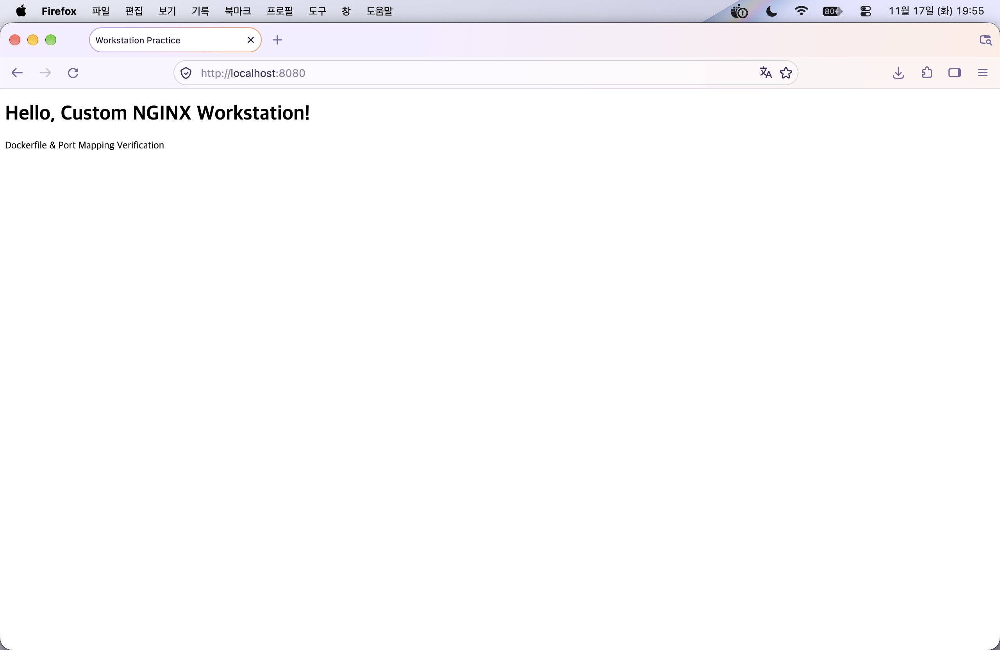
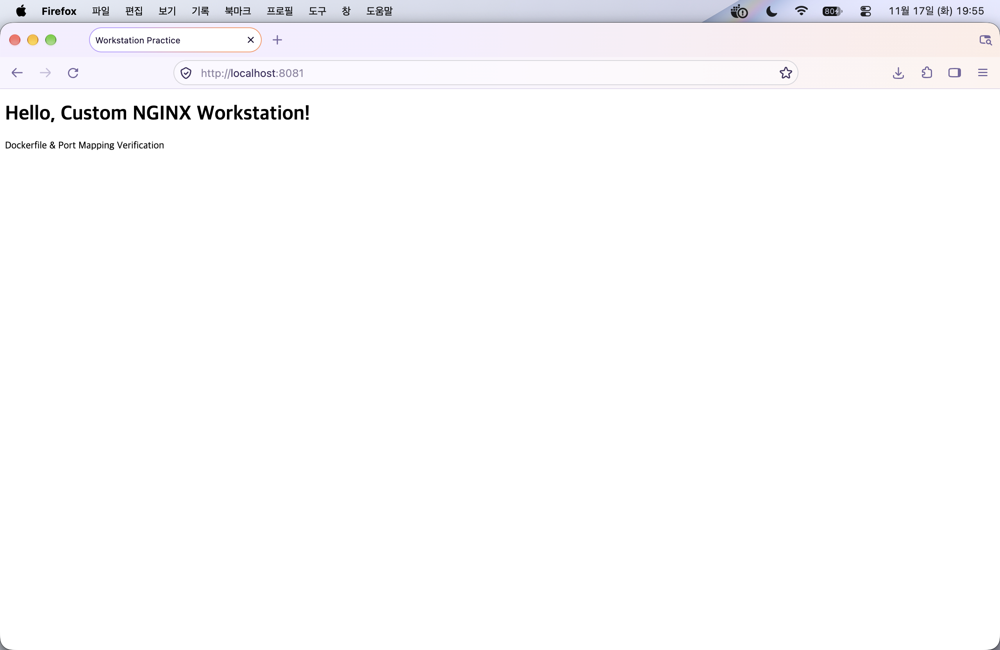
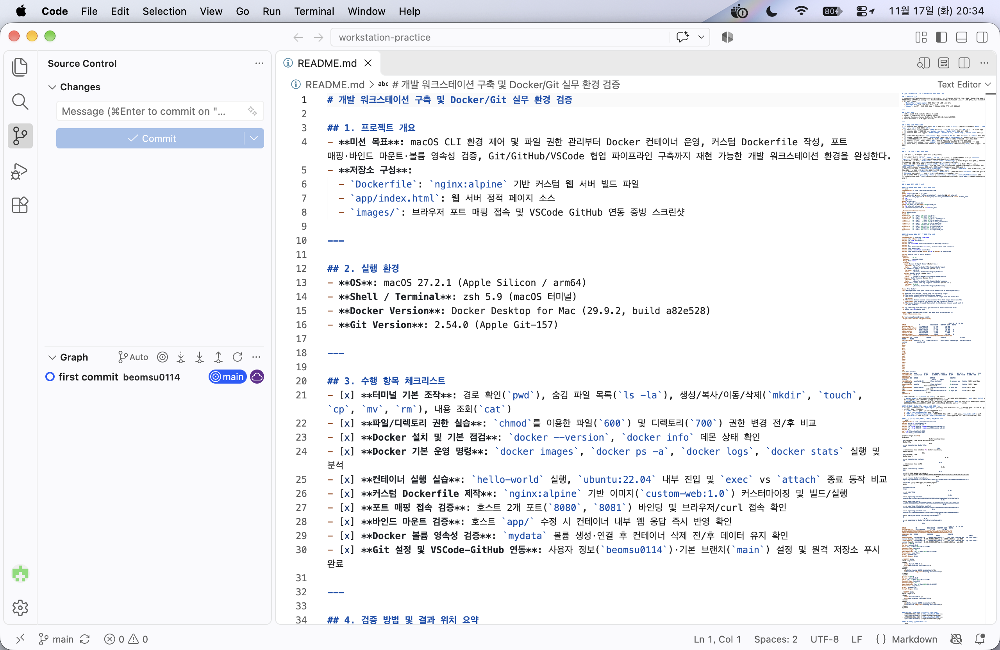

# 개발 워크스테이션 구축 및 Docker/Git 실무 환경 검증

## 1. 프로젝트 개요
- **미션 목표**: macOS CLI 환경 제어 및 파일 권한 관리부터 Docker 컨테이너 운영, 커스텀 Dockerfile 작성, 포트 매핑·바인드 마운트·볼륨 영속성 검증, Git/GitHub/VSCode 협업 파이프라인 구축까지 재현 가능한 개발 워크스테이션 환경을 완성한다.
- **저장소 구성**:
  - `Dockerfile`: `nginx:alpine` 기반 커스텀 웹 서버 빌드 파일
  - `app/index.html`: 웹 서버 정적 페이지 소스
  - `images/`: 브라우저 포트 매핑 접속 및 VSCode GitHub 연동 증빙 스크린샷

---

## 2. 실행 환경
- **OS**: macOS 27.2.1 (Apple Silicon / arm64)
- **Shell / Terminal**: zsh 5.9 (macOS 터미널)
- **Docker Version**: Docker Desktop for Mac (29.9.2, build a82e528)
- **Git Version**: 2.54.0 (Apple Git-157)

---

## 3. 수행 항목 체크리스트
- [x] **터미널 기본 조작**: 경로 확인(`pwd`), 숨김 파일 목록(`ls -la`), 생성/복사/이동/삭제(`mkdir`, `touch`, `cp`, `mv`, `rm`), 내용 조회(`cat`)
- [x] **파일/디렉토리 권한 실습**: `chmod`를 이용한 파일(`600`) 및 디렉토리(`700`) 권한 변경 전/후 비교
- [x] **Docker 설치 및 기본 점검**: `docker --version`, `docker info` 데몬 상태 확인
- [x] **Docker 기본 운영 명령**: `docker images`, `docker ps -a`, `docker logs`, `docker stats` 실행 및 분석
- [x] **컨테이너 실행 실습**: `hello-world` 실행, `ubuntu:22.04` 내부 진입 및 `exec` vs `attach` 종료 동작 비교
- [x] **커스텀 Dockerfile 제작**: `nginx:alpine` 기반 이미지(`custom-web:1.0`) 커스터마이징 및 빌드/실행
- [x] **포트 매핑 접속 검증**: 호스트 2개 포트(`8080`, `8081`) 바인딩 및 브라우저/curl 접속 확인
- [x] **바인드 마운트 검증**: 호스트 `app/` 수정 시 컨테이너 내부 웹 응답 즉시 반영 확인
- [x] **Docker 볼륨 영속성 검증**: `mydata` 볼륨 생성·연결 후 컨테이너 삭제 전/후 데이터 유지 확인
- [x] **Git 설정 및 VSCode-GitHub 연동**: 사용자 정보(`beomsu0114`)·기본 브랜치(`main`) 설정 및 원격 저장소 푸시 완료

---

## 4. 검증 방법 및 결과 위치 요약

| 검증 항목 | 검증 명령어 | 확인 내용 | 결과 위치 |
| :--- | :--- | :--- | :--- |
| CLI 및 권한 제어 | `ls -la`, `chmod`, `ls -ld` | 파일/디렉토리 생성·이동·삭제 및 권한(`rw-------`, `rwx------`) 적용 여부 | [5.1절](#51-터미널-기본-조작-및-권한-실습-로그) |
| Docker 데몬 및 운영 | `docker info`, `docker stats`, `docker logs` | Docker Engine 정상 가동 및 컨테이너 리소스·로그 출력 확인 | [5.2절](#52-docker-설치-점검-및-기본-운영-로그) |
| 커스텀 웹 서버 & 포트 매핑 | `docker build`, `docker run -p`, `curl -i` | 커스텀 이미지 빌드 및 `localhost:8080`, `localhost:8081` HTTP 200 응답 | [5.3절](#53-커스텀-dockerfile-제작-및-포트-매핑-검증), [8080 캡처](./images/browser-8080.png), [8081 캡처](./images/browser-8081.png) |
| 바인드 마운트 반영 | `docker run -v $(pwd)/app:...`, `curl` | 호스트 `index.html` 수정 후 컨테이너 재시작 없이 응답 본문 변경 확인 | [5.4절](#54-바인드-마운트-반영-검증) |
| 볼륨 데이터 영속성 | `docker volume create`, `docker rm -f` | 기존 컨테이너(`vol-test1`) 삭제 후 신규 컨테이너(`vol-test2`)에서 파일 유지 확인 | [5.5절](#55-docker-볼륨-영속성-검증) |
| Git & GitHub 연동 | `git config --list` | `user.name`, `user.email`, `init.defaultBranch=main` 설정 및 VSCode-GitHub 연동 | [5.6절](#56-git-설정-및-githubvscode-연동-증거), [연동 캡처](./images/vscode-github.png) |

---

## 5. 상세 수행 로그 및 증거

### 5.1 터미널 기본 조작 및 권한 실습 로그
```bash
x@MacBook-Air ~ % cd ~/workstation-practice
pwd
mkdir -p cli_test && cd cli_test
touch empty.txt && echo "hello workstation" > note.txt && cat note.txt
cp note.txt note_copy.txt && mv note_copy.txt note_renamed.txt && touch .hidden_file
ls -la
rm empty.txt
mkdir private_dir
ls -ld note.txt private_dir
chmod 600 note.txt && chmod 700 private_dir
ls -ld note.txt private_dir
cd ~/workstation-practice && rm -rf cli_test

/Users/x/workstation-practice
hello workstation
total 16
drwxr-xr-x  6 x  staff  192 11월 17 19:14 .
drwxr-xr-x@ 8 x  staff  256 11월 17 19:14 ..
-rw-r--r--  1 x  staff    0 11월 17 19:14 .hidden_file
-rw-r--r--  1 x  staff    0 11월 17 19:14 empty.txt
-rw-r--r--  1 x  staff   18 11월 17 19:14 note_renamed.txt
-rw-r--r--  1 x  staff   18 11월 17 19:14 note.txt
-rw-r--r--  1 x  staff  18 11월 17 19:14 note.txt
drwxr-xr-x  2 x  staff  64 11월 17 19:14 private_dir
-rw-------  1 x  staff  18 11월 17 19:14 note.txt
drwx------  2 x  staff  64 11월 17 19:14 private_dir
```

### 5.2 Docker 설치 점검 및 기본 운영 로그
```bash
x@MacBook-Air ~ % docker --version
docker info | head -n 20
docker run --rm hello-world
docker images
docker run -d --name ubuntu-lab ubuntu:22.04 sleep infinity
docker ps
docker exec ubuntu-lab bash -lc "ls / && echo 'exec test success'"
docker logs ubuntu-lab
docker stats --no-stream ubuntu-lab
docker stop ubuntu-lab && docker ps -a && docker rm ubuntu-lab

Docker version 29.9.2, build a82e528
Client:
 Version:    29.9.2
 Context:    desktop-linux
 Debug Mode: false
 Plugins:
  agent: Docker AI Agent Runner (Docker Inc.)
    Version:  v1.152.0
    Path:     /Users/x/.docker/cli-plugins/docker-agent
  ai: Docker AI Agent - Ask Gordon (Docker Inc.)
    Version:  v1.33.0
    Path:     /Users/x/.docker/cli-plugins/docker-ai
  buildx: Docker Buildx (Docker Inc.)
    Version:  v0.38.1
    Path:     /Users/x/.docker/cli-plugins/docker-buildx
  compose: Docker Compose (Docker Inc.)
    Version:  v5.6.1
    Path:     /Users/x/.docker/cli-plugins/docker-compose
  debug: Get a shell into any image or container (Docker Inc.)
    Version:  0.49.0
    Path:     /Users/x/.docker/cli-plugins/docker-debug

Hello from Docker!
This message shows that your installation appears to be working correctly.

To generate this message, Docker took the following steps:
 1. The Docker client contacted the Docker daemon.
 2. The Docker daemon pulled the "hello-world" image from the Docker Hub.
    (arm64v8)
 3. The Docker daemon created a new container from that image which runs the
    executable that produces the output you are currently reading.
 4. The Docker daemon streamed that output to the Docker client, which sent it
    to your terminal.

To try something more ambitious, you can run an Ubuntu container with:
 $ docker run -it ubuntu bash

Share images, automate workflows, and more with a free Docker ID:
 https://hub.docker.com/

For more examples and ideas, visit:
 https://docs.docker.com/get-started/

                                                                                                                                                               i Info →   U  In Use
IMAGE                ID             DISK USAGE   CONTENT SIZE   EXTRA
custom-web:1.0       f717eb0bcc5d       93.2MB         26.3MB        
hello-world:latest   c567b231f656       22.6kB         10.3kB        
my-web-server:1.0    a58ec32b518d       93.2MB         26.3MB    U   
nginx:alpine         713fc2ebfd92       94.1MB         27.2MB    U   
ubuntu:22.04         9abcaffc92a5        110MB           30MB        
ubuntu:latest        6a06111c3b0a        181MB         44.9MB    U   
4dcb7b3c8efa1eb4f2da26c94858127a18a946783f012dbfff06a34d8fd4c84c
CONTAINER ID   IMAGE          COMMAND            CREATED                  STATUS                  PORTS     NAMES
4dcb7b3c8efa   ubuntu:22.04   "sleep infinity"   Less than a second ago   Up Less than a second             ubuntu-lab
bin
boot
dev
etc
home
lib
media
mnt
opt
proc
root
run
sbin
srv
sys
tmp
usr
var
exec test success
CONTAINER ID   NAME         CPU %     MEM USAGE / LIMIT     MEM %     NET I/O      BLOCK I/O     PIDS
4dcb7b3c8efa   ubuntu-lab   0.00%     6.258MiB / 7.748GiB   0.08%     890B / 84B   4.82MB / 0B   1
ubuntu-lab
CONTAINER ID   IMAGE               COMMAND                   CREATED         STATUS                                PORTS     NAMES
4dcb7b3c8efa   ubuntu:22.04        "sleep infinity"          4 seconds ago   Exited (137) Less than a second ago             ubuntu-lab
0ea2672d0951   ubuntu              "sleep infinity"          8 days ago      Exited (137) 7 days ago                         test-container-2
3a36d4bd46e9   nginx:alpine        "/docker-entrypoint.…"   8 days ago      Exited (0) 7 days ago                           bind-test
d6a517c1b09e   my-web-server:1.0   "/docker-entrypoint.…"   8 days ago      Exited (0) 7 days ago                           my-web
ubuntu-lab
```
- **컨테이너 종료/유지(`attach` vs `exec`) 관찰 정리**:
  - `docker attach`: 컨테이너의 메인 프로세스(PID 1) 표준 입출력에 직접 연결되므로, `exit` 또는 `Ctrl+C` 입력 시 메인 프로세스가 종료되어 **컨테이너 자체가 중지(Exited)**된다.
  - `docker exec`: 실행 중인 컨테이너 내부에 별도의 보조 프로세스(`bash`)를 새로 실행해 진입하므로, 작업 후 `exit`로 빠져나와도 메인 프로세스에는 영향이 없어 **컨테이너가 실행(Up) 상태로 유지**된다.

### 5.3 커스텀 Dockerfile 제작 및 포트 매핑 검증
- **선택한 베이스 이미지**: `nginx:alpine` (경량화된 공식 NGINX 이미지로 빌드 속도가 빠르고 리소스 점유가 적어 선택)
- **적용한 커스텀 포인트**:
  1. `LABEL`: 이미지 타이틀 및 설명 메타데이터 명시
  2. `ENV`: `APP_ENV=production` 환경변수 설정
  3. `COPY app/ /usr/share/nginx/html/`: 기본 NGINX 환영 페이지를 직접 작성한 `app/index.html`로 교체
  4. `HEALTHCHECK`: 30초 간격으로 `http://localhost:80/` 응답을 자동 점검하여 컨테이너 정상 상태 확인

#### 빌드 및 2개 포트(`8080`, `8081`) 실행·응답 로그
```bash
x@MacBook-Air ~ % cd ~/workstation-practice
docker build -t custom-web:1.0 .
docker images custom-web:1.0
docker run -d -p 8080:80 --name web-8080 custom-web:1.0
docker run -d -p 8081:80 --name web-8081 custom-web:1.0
docker ps
curl -i http://localhost:8080
curl -i http://localhost:8081

[+] Building 0.1s (7/7) FINISHED                                                                                                                               docker:desktop-linux
 => [internal] load build definition from Dockerfile                                                                                                                           0.0s
 => => transferring dockerfile: 403B                                                                                                                                           0.0s
 => [internal] load metadata for docker.io/library/nginx:alpine                                                                                                                0.0s
 => [internal] load .dockerignore                                                                                                                                              0.0s
 => => transferring context: 2B                                                                                                                                                0.0s
 => [internal] load build context                                                                                                                                              0.0s
 => => transferring context: 59B                                                                                                                                               0.0s
 => [1/2] FROM docker.io/library/nginx:alpine@sha256:713fc2ebfd92e8217db451477182ee91944b123d2b1ee9fd5a8c6e91ca6c3a11                                                          0.0s
 => => resolve docker.io/library/nginx:alpine@sha256:713fc2ebfd92e8217db451477182ee91944b123d2b1ee9fd5a8c6e91ca6c3a11                                                          0.0s
 => CACHED [2/2] COPY app/ /usr/share/nginx/html/                                                                                                                              0.0s
 => exporting to image                                                                                                                                                         0.0s
 => => exporting layers                                                                                                                                                        0.0s
 => => exporting manifest sha256:abef2141bb77a575560b1407e22e070497c32daf1aed188d677a737e8e71ca7b                                                                              0.0s
 => => exporting config sha256:61663e218f6de78f63f0575d270d5dc92e2922525df5b0fa59ced8a9d3237a13                                                                                0.0s
 => => exporting attestation manifest sha256:35589ac951a8d990700253a4f6ce35ea4179d85936e82f496bc50aeab925a01b                                                                  0.0s
 => => exporting manifest list sha256:54ffcce602e6460be4167c8a9dc05d8172cb58f34b2bf52e1780dd46e9b6c02c                                                                         0.0s
 => => naming to docker.io/library/custom-web:1.0                                                                                                                              0.0s
 => => unpacking to docker.io/library/custom-web:1.0                                                                                                                           0.0s
                                                                                                                                                               i Info →   U  In Use
IMAGE            ID             DISK USAGE   CONTENT SIZE   EXTRA
custom-web:1.0   54ffcce602e6       93.2MB         26.3MB        
2c4667ad8628c55167a92db735a3411c20f38a73cfcb8b476248ff2fb716cf87
c0b4f26520e4088f4387af7f66f9d5cac00bc08b899d808b3b9a9e4ed427266d
CONTAINER ID   IMAGE            COMMAND                   CREATED                  STATUS                                     PORTS                                     NAMES
c0b4f26520e4   custom-web:1.0   "/docker-entrypoint.…"   Less than a second ago   Up Less than a second (health: starting)   0.0.0.0:8081->80/tcp, [::]:8081->80/tcp   web-8081
2c4667ad8628   custom-web:1.0   "/docker-entrypoint.…"   Less than a second ago   Up Less than a second (health: starting)   0.0.0.0:8080->80/tcp, [::]:8080->80/tcp   web-8080
HTTP/1.1 200 OK
Server: nginx/1.31.8
Date: Tue, 17 Nov 2026 10:47:12 GMT
Content-Type: text/html
Content-Length: 232
Last-Modified: Tue, 17 Nov 2026 04:43:19 GMT
Connection: keep-alive
ETag: "6afbdb67-e8"
Accept-Ranges: bytes

<!DOCTYPE html>
<html lang="ko">
<head>
  <meta charset="UTF-8" />
  <title>Workstation Practice</title>
</head>
<body>
  <h1>Hello, Custom NGINX Workstation!</h1>
  <p>Dockerfile &amp; Port Mapping Verification</p>
</body>
</html>
HTTP/1.1 200 OK
Server: nginx/1.31.8
Date: Tue, 17 Nov 2026 10:47:12 GMT
Content-Type: text/html
Content-Length: 232
Last-Modified: Tue, 17 Nov 2026 04:43:19 GMT
Connection: keep-alive
ETag: "6afbdb67-e8"
Accept-Ranges: bytes

<!DOCTYPE html>
<html lang="ko">
<head>
  <meta charset="UTF-8" />
  <title>Workstation Practice</title>
</head>
<body>
  <h1>Hello, Custom NGINX Workstation!</h1>
  <p>Dockerfile &amp; Port Mapping Verification</p>
</body>
</html>
```

#### 브라우저 접속 증빙 (주소창 및 포트 포함)
- **포트 8080 접속 화면 (`http://localhost:8080`)**:
  
- **포트 8081 접속 화면 (`http://localhost:8081`)**:
  

### 5.4 바인드 마운트 반영 검증
```bash
x@MacBook-Air workstation-practice % docker run -d -p 8082:80 --name web-bind -v "$(pwd)/app:/usr/share/nginx/html" custom-web:1.0
curl -s http://localhost:8082 | grep "<h1>"
sed -i.bak 's/Hello, Custom NGINX Workstation!/Bind Mount Updated Successfully!/' app/index.html
sleep 1
curl -s http://localhost:8082 | grep "<h1>"
mv app/index.html.bak app/index.html
docker rm -f web-bind

0dbafbf5ed0f6b7f9f4b4b725c3fd23bf5f4abb0f9fc54065b087d6962fee260
  <h1>Hello, Custom NGINX Workstation!</h1>
  <h1>Bind Mount Updated Successfully!</h1>
web-bind
```
- **호스트 변경 전/후 비교**: 호스트의 `./app` 디렉토리를 컨테이너의 `/usr/share/nginx/html`에 바인드 마운트한 결과, 호스트에서 `app/index.html` 내용을 수정하자 컨테이너 재시작 없이 응답 본문이 `Hello, Custom NGINX Workstation!`에서 `Bind Mount Updated Successfully!`로 즉시 반영되었다.

### 5.5 Docker 볼륨 영속성 검증
```bash
x@MacBook-Air workstation-practice % docker volume create mydata
docker volume ls

docker run -d --name vol-test1 -v mydata:/data ubuntu:22.04 sleep infinity
docker exec vol-test1 bash -lc "echo 'Volume Data Persists!' > /data/hello.txt && cat /data/hello.txt"

docker rm -f vol-test1
docker ps -a | grep vol-test1 || echo "vol-test1 deleted"

docker run -d --name vol-test2 -v mydata:/data ubuntu:22.04 sleep infinity
docker exec vol-test2 bash -lc "cat /data/hello.txt"

docker rm -f vol-test2

mydata
DRIVER    VOLUME NAME
local     mydata
2df93f94c6977aa7b392be2ddf28fa6b30528482e53f343a6c6b3df58d106574
Volume Data Persists!
vol-test1
vol-test1 deleted
078eeeaa3df4594d6b04f0da3f798477aedfe543cd0a76dd643e508291959937
Volume Data Persists!
vol-test2
```
- **컨테이너 삭제 전/후 비교**: `vol-test1` 컨테이너에서 `/data/hello.txt`를 작성한 뒤 `docker rm -f vol-test1`로 컨테이너를 삭제했으나, Named Volume(`mydata`)에 데이터가 보존되어 새 컨테이너(`vol-test2`) 연결 시에도 `Volume Data Persists!`가 정상 조회되었다.

### 5.6 Git 설정 및 GitHub/VSCode 연동 증거
```bash
x@MacBook-Air workstation-practice % git config --global user.name "beomsu0114"
git config --global user.email "beomsu0114@***.com"
git config --global init.defaultBranch main
git config --list

credential.helper=osxkeychain
init.defaultbranch=main
user.name=beomsu0114
user.email=beomsu0114@***.com
init.defaultbranch=main
```
- **VSCode GitHub 연동 완료 화면**:
  

---

## 6. 트러블슈팅 기록 (2건)

### 사례 1: macOS Docker Desktop 바인드 마운트 동기화 지연으로 인한 이전 내용 출력
- **문제**: 호스트에서 `sed`로 `app/index.html`을 수정한 직후 딜레이 없이 `curl http://localhost:8082`를 연속 호출하자, 수정된 문구가 아니라 이전 문구(`Hello, Custom NGINX Workstation!`)가 그대로 출력되었다.
- **원인 가설**: macOS 환경의 Docker Desktop은 가상화 파일 공유 레이어를 거쳐 호스트 파일 변경 이벤트를 컨테이너로 전달하므로, 파일 수정 직후 수십 밀리초 이내에 요청을 보내면 동기화 완료 전 캐시된 내용이 응답될 수 있다.
- **확인**: 파일 수정 명령 직후 `sleep 1`을 추가하여 1초 대기한 뒤 다시 `curl` 요청을 보냈을 때 변경된 `<h1>Bind Mount Updated Successfully!</h1>`가 정상 출력되는 것을 확인했다.
- **해결 및 재발 방지**: 검증 스크립트 및 자동화 테스트 시 호스트 파일 변경 직후 짧은 대기 시간(`sleep 1`)을 두어 파일 시스템 동기화가 완료된 후 검증하도록 절차를 개선했다.

### 사례 2: macOS `zsh` 쉘에서 주석(`#`) 및 스마트 따옴표 붙여넣기 오류
- **문제**: 문서에서 복사한 명령어를 macOS 기본 `zsh` 터미널에 붙여넣을 때 `#` 주석 줄에서 `zsh: command not found: #` 오류가 발생하거나, 둥근 따옴표(`“ ”`)로 인해 `dquote>` 프롬프트에 갇혀 명령이 실행되지 않는 현상이 발생했다.
- **원인 가설**: `zsh`는 대화형 쉘 기본 설정(`INTERACTIVE_COMMENTS` 비활성)상 `#`을 주석이 아닌 명령어로 해석하며, 리치 텍스트 에디터에서 변환된 스마트 따옴표(`“ ”`)는 쉘의 문자열 구분자(`" "`)로 인식되지 않기 때문일 것이다.
- **확인**: `Control + C`로 `dquote>` 상태를 빠져나온 뒤, 주석을 제거하고 표준 ASCII 직선 따옴표(`"`)만 사용한 명령어를 실행하자 모든 설정이 정상 반영되었다.
- **해결 및 재발 방지**: 터미널 실행용 명령어는 주석 줄을 분리하고 표준 따옴표(`"`)만 사용하도록 정리하여 재현성을 확보했다.
